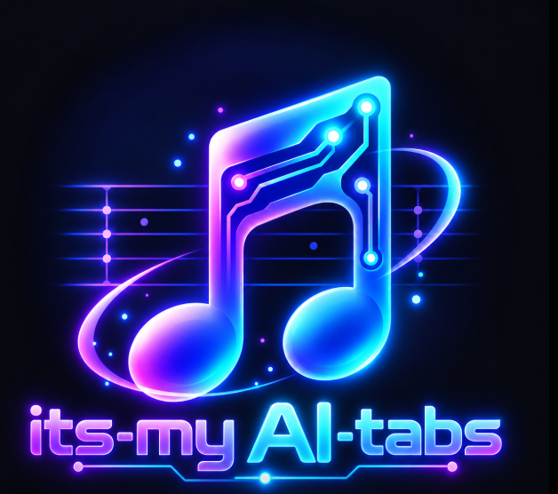

<h1>🎸 its-my-AI-tabs</h1>

<h3>Free. Open source. No subscriptions. No bullshit.</h3>

---

<h2>Why This Project?</h2>

I wanted a free alternative that respects users' time and work.

No forced interface changes, no unnecessary disruptions, and no losing hours of work or practice because of an update.

Development versions will be available for testing major changes before they reach stable releases.

Community feedback matters. If something works, we shouldn't break it.

---

<h2>🎵 BYOM — Bring Your Own Music</h2>

<strong>We provide the software. You provide the music.</strong>

No songs, recordings, videos, or sample tabs are intended to be distributed with this project.

Users are responsible for the content they import and share, including any necessary rights or permissions.

---

<h2>🚧 Project Status</h2>

<strong>Early development.</strong>

<ul>
  <li>🎸 Guitar Pro tablature playback works.</li>
  <li>🎬 MP4 video support is experimental.</li>
  <li>🤖 OpenMuik AI transcription is planned.</li>
</ul>

---

<h2>🙏 Credits & License</h2>

Based on <a href="https://github.com/louislam/its-mytabs">It's MyTabs</a> by <a href="https://github.com/louislam">Louis Lam</a>.

Tablature rendering powered by <a href="https://github.com/CoderLine/alphaTab">AlphaTab</a>.

Original copyright notices and third-party licenses are preserved.

See <a href="./LICENSE">LICENSE</a> for details.

---

<h3>🎶 Keep playing. Keep learning. Enjoy the music!</h3>

<strong>Your music. Your tabs. Your workflow.</strong>

